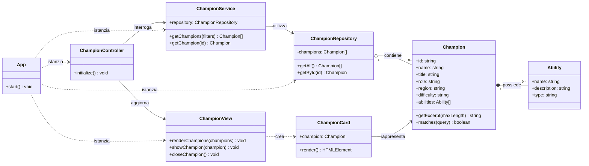

# Diagramma UML delle classi

## Note sulle relazioni

- **Composizione** Champion–Ability: le abilità appartengono al modello di un campione.
- **Aggregazione** Repository–Champion: il repository mantiene la collezione.
- **Associazione / dipendenza** Controller–Service–View: gli oggetti collaborano tramite riferimenti iniettati nel costruttore.
- **Dipendenza di creazione** View–Card: la view costruisce le schede al momento del rendering.
